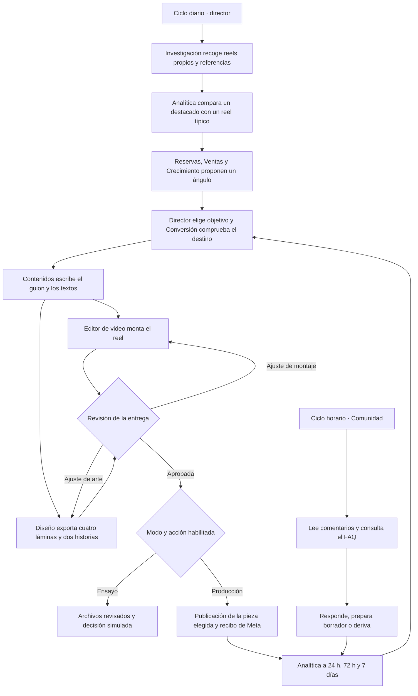

# Cómo trabaja el equipo cada día

El director de Codex comparte un brief entre los agentes y conserva los archivos de cada jornada. Puede avanzar desde el hallazgo de un reel hasta la revisión de un MP4, un carrusel y dos historias. En producción, el publicador cuenta con una sola plaza de feed por cuenta y fecha local. Comunidad trabaja por separado para poder atender una pregunta sobre una pieza anterior mientras Video prepara la de hoy.



## Traspasos y decisiones

| Responsable | Qué recibe y qué comprueba | Qué entrega al siguiente agente |
| --- | --- | --- |
| Director | Configuración, ficha de marca, materiales disponibles y las últimas siete campañas de la misma cuenta. Abre la carpeta con `python campana.py iniciar`. | `brief.md` con cuenta, fecha, objetivo, alcance y próximo responsable. Retoma el expediente existente si el trabajo ya comenzó. |
| Investigación | Cuenta propia y cuentas profesionales configuradas. Cuando haya acceso, ejecuta `python radar.py capturar` y `python radar.py clasificar`. | En la carpeta de referencias, una ficha con enlace, fecha, antigüedad, vistas disponibles, mediana de esa cuenta, tamaño de muestra y lo que pudo verse. |
| Analítica | El candidato y un reel típico de la misma cuenta. Observa los primeros segundos, el desarrollo, cuándo aparece la prueba y cómo cierra la pieza. | Una hipótesis comprobable y una explicación alternativa. Identifica qué proviene del video, qué procede del caption y qué se desconoce. |
| Reservas, Ventas y Crecimiento | Hipótesis, evidencia de marca y resultados anteriores. Cada responsable propone público, objeción, una acción y un indicador. | El director elige la propuesta con evidencia y recursos. Si dos son igual de viables, prioriza el objetivo menos atendido durante los últimos siete días. |
| Conversión | Objetivo seleccionado, CTA, oferta y canal de respuesta. | En el brief, destino, responsable de atenderlo y método de conteo. Señala una oferta vencida o un enlace pendiente al director, que puede cambiar el enfoque. |
| Contenidos | Brief acordado y fórmula de la referencia. | Tres aperturas candidatas y la razón de la seleccionada. Guarda guion, plan de planos, textos, sonidos, transiciones y segundos en `guion/`, junto a `escaleta.json` y `pie-de-foto.txt` del reel. Entrega al diseñador los textos de las cuatro láminas, dos historias y `carrusel/pie-de-foto.txt`. |
| Editor de video | Escaleta, originales y presupuesto. | Un MP4 vertical completo en terminados. En `guion/` registra decisiones de montaje, procedencia de medios, proyecto editable y coste si intervino un proveedor de pago. |
| Diseño | Textos finales, evidencia visual y fuentes. | Fuentes en `carrusel/arte/`, seis JPG numerados, dos vistas previas y ZIP en la entrega del carrusel. Cuando se solicite Canva, registra también los enlaces editables. |
| Revisión | Archivos finales, captions, alcance y evidencia, incluidos los derechos de los medios. | Dictamen en `revision/` con correcciones por segundo o por lámina. Si aprueba, vincula cuenta, fecha, formato, contenido y orden a las huellas de los archivos finales. Sigue el contrato de `INSTAGRAM.md`. |
| Publicación | Pieza elegida para el feed, archivos revisados y modo de operación. | En ensayo registra la elección en el brief. En producción usa el adaptador y guarda el ID remoto en el expediente. Las dos historias quedan exportadas para su entrega. |
| Comunidad y Analítica | Comentarios en medios propios, respuestas anteriores, FAQ, ID y hora real de publicación. | Respuestas o excepciones, consultas agrupadas por intención y observaciones comparables. El director lleva al brief siguiente una variable concreta que cambiará. |

El director reparte tareas simultáneas solo cuando ya disponen de su insumo. Los roles de objetivo pueden proponer ángulos en paralelo. El editor y el diseñador pueden producir en paralelo después de que el director fije la oferta y el CTA. El revisor devuelve una corrección concreta al oficio adecuado. Si el material no puede sostener una afirmación, el director escoge otra pieza vigente o cierra la jornada con el motivo documentado.

## Cómo se detecta un reel destacado

El radar conserva en SQLite muestras de reels observados entre las 60 y las 84 horas de edad. Para cada reel elige la muestra más próxima a las 72 horas. Divide sus vistas por la mediana de entre 5 y 12 reels previos de la misma cuenta y con una edad comparable. Con una mediana de 1.000, un reel con 3.200 vistas tiene un múltiplo de 3,2. El comando `python radar.py demo` reproduce ese cálculo con datos ficticios.

Para el ciclo diario, Investigación puede empezar examinando el material reciente por encima del doble de la mediana y anotar cuántos comparables sustentan el hallazgo. Si el historial es corto, faltan vistas o el denominador es cero, el director puede encargar un experimento original e identificar su procedencia. Los datos de otras cuentas dependen del acceso y de los campos que entregue Meta. Los clips y enlaces guardados por la marca también pueden servir para estudiar patrones visuales.

Por ejemplo, el analista puede observar que una pieza abre con el detalle de una rueda y revela el taller en el tercer segundo. Su hipótesis podría ser que resolver esa curiosidad ayuda a sostener la atención. El guionista puede probarla con una acción distinta del taller, sus propias palabras y un cierre medible. El diseñador puede aplicar el mismo mecanismo visual entre la portada y la segunda lámina. Para repetir la prueba, conserva el objetivo y cambia una variable por vez.

## Estructura del video y del carrusel

Cada cuenta y cada jornada tienen un expediente en `campanas/<cuenta>/<AAAA-MM-DD>/`. La carpeta de video reproduce la organización del Explorador.

```text
<campaña>/
  brief.md
  guion/
    escaleta.json
    pie-de-foto.txt
  Videos del proyecto - Reel de Instagram/
    01 - Videos crudos/
    02 - Referencias/
    03 - Videos terminados/
  carrusel/
    arte/
    pie-de-foto.txt
    entrega/
  revision/
```

**01 - Videos crudos** reúne las grabaciones originales, fotos, audios y planos de apoyo autorizados para montar. **02 - Referencias** reúne ejemplos, sus enlaces y fichas de análisis. Cuando haya acceso legítimo a una descarga, se puede guardar con yt-dlp y analizarla con la pauta de `ig-viral`. Si solo se dispone del enlace, el análisis sigue con la evidencia observable. **03 - Videos terminados** conserva las versiones completas, por ejemplo `01 - Reel.mp4` y `02 - Reel.mp4`. El número más alto corresponde al resultado más reciente. Las pruebas de efectos, cachés y documentos de producción se guardan fuera de esa carpeta.

### Edición del reel

En una PC nueva, conecta la cuenta de ElevenLabs una vez con `codex mcp add elevenlabs --url https://api.elevenlabs.io/v1/mcp` y completa el acceso en la página del proveedor. Si el servidor ya está registrado, `codex mcp login elevenlabs` reanuda la autorización. El operador usa la herramienta de voz del MCP, entrega el texto literal aprobado y guarda el audio original, el ID de generación, el Flow y la huella del archivo. Registra en la ficha de marca el nombre y el identificador de la voz autorizada. Los créditos incluidos de ElevenLabs y los de invideo pertenecen a cuentas y servicios distintos. [MCP oficial de ElevenLabs](https://elevenlabs.io/docs/eleven-api/resources/mcp-server)

1. El guionista entrega `guion/voz-reel-NN.json` con una lista `frases`. Cada entrada contiene `id`, `texto` hablado literal y `objetivo_visual` que explica qué necesita ver el público. El director aprueba esas frases. Si existe un referente estético, Revisión registra qué rasgos se van a adaptar.
2. El equipo obtiene la narración completa de ElevenLabs y conserva la pista de voz y su procedencia. Ejecuta Whisper sobre esa pista, escucha las palabras dudosas y corrige el SRT con el guion aprobado. Los silencios y la firma visual pueden quedar libres de subtítulos.
3. Ahora el editor busca por frase en el catálogo. Reproduce los originales y anota qué acción corresponde a qué palabras. En el objeto `guion_voz` de la orden incluye `guion_sha256`, `voz`, `voz_sha256`, `subtitulos` y `tomas`. Cada toma lleva `frase`, `archivo`, `desde` y `hasta` en el original, `entrada` y `salida` en el reel y `motivo` visible. Las rutas son relativas a la campaña. Un cambio de frase o voz exige comprobar de nuevo la sincronía y el plano.
4. El director valida la orden y entrega al editor las operaciones de las siete herramientas con sus segundos. El revisor escucha la mezcla, lee los subtítulos sobre un teléfono y verifica que la imagen demuestre lo que la voz afirma. Mantén la procedencia del logo oficial con los recursos de identidad de la cuenta.

El director selecciona la evidencia y la hipótesis y deja en el brief el ángulo, el objetivo y el CTA. El guionista determina qué debe ver y oír la audiencia para entenderlos. El editor recibe una orden concreta por escena y puede proponer un ajuste de montaje al guionista, quien actualiza la orden si cambia el mensaje. El máster local del proyecto es vertical en 1080 × 1920 a 30 fps.

**Orden anterior al montaje.** En `guion/montaje-reel-NN.json` se guarda la duración y una lista de órdenes. Cada una lleva `id`, `entrada`, `salida` en segundos, `instruccion`, `herramienta`, `insumo` y `resultado`. Por ejemplo, si el director eligió «mostrar qué ocurre en el taller», una orden de HyperFrames puede cubrir de 4,0 a 6,1 segundos, recibir dos tomas de la sede y pedir una pantalla dividida donde se reconozca la relación entre ambas. Para voz, transcripción o ensamblaje general, el guionista indica el intervalo completo que cubren. Se admiten solapes y varias órdenes para la misma herramienta. Antes de editar, el director ejecuta `python campana.py validar-orden RUTA --revision N` y entrega al editor la hoja y su `orden_sha256`.

**Selección de Converzzo por escena.** Dirección y Guion eligen entre las skills de `efectos-converzzo` y `tipografia-converzzo` según la acción visible, la locución y el objetivo del reel. El encargo puede expresarse en lenguaje natural. Por ejemplo, si el cepillo levanta una mancha en medio segundo, se puede ralentizar ese gesto. Si la comparación depende del color, se conserva el color original en ambos planos. Cuando el plano y la voz ya explican el punto, basta el corte.

En las órdenes nuevas usa el nombre del plugin en `herramienta` y su identificador de catálogo en `skill`. En `instruccion` especifica ajuste y referencia. Edición conserva el plan que renderizó, los IDs atendidos y la evidencia local por revisión. Si el efecto cambia la velocidad, verifica la sincronía del siguiente corte con la voz. Ambos plugins son opcionales por pieza. [Instalación, traspasos y ejemplo validable](integraciones/converzzo/README.md)

| Herramienta | Insumo y encargo que prepara el guionista | Evidencia que devuelve el editor |
| --- | --- | --- |
| ElevenLabs | Texto hablado y voz de marca. Una síntesis nueva requiere acceso y presupuesto para la cotización aplicable. | Pista de voz, frase utilizada, procedencia y tiempos. Si la voz autorizada ya contiene la frase, se puede recortar sin volver a sintetizarla. |
| Whisper | La pista final de voz y el idioma español. Tener instalado Whisper con un modelo local o recuperar la alineación de esa misma toma. | Transcripción con tiempos y correcciones escuchadas. Si se recorta la voz, desplazar las marcas al nuevo reloj. |
| invideo | Montaje con los medios del guion, secuencia editable del equipo y pistas de voz y ambiente. Requiere sesión y permisos del espacio. | URL del proyecto o secuencia identificable y registro de qué revisión se editó. Para volver a usar un trabajo, identificar el corte o las pistas heredadas. |
| HyperFrames | Composición HTML con duración, fuentes autorizadas y dos encuadres o elementos que el público debe relacionar. | Archivo de composición o plano renderizado, con entrada y salida en el reel. |
| Remotion | Escaleta, voz y marcas revisadas para situar rótulos, transiciones y subtítulos legibles. | Composición o render y referencia al JSON de tiempos. |
| gbro-collage-broll | Metáfora ligada a una frase del guion, material a representar y espacio en la secuencia. | Clip de collage aprobado. Para solicitar una generación nueva, seguir las etapas de metáfora, estática y animación de la skill, comprobar su acceso y presupuesto. |
| ClaudeAnimationBase | Objeto o gesto específico que necesita un acento animado y duración del efecto. | Fuente o animación de la intervención y segundo en que aparece. |

El editor registra la versión de cada recurso y cuáles fueron los costes de la ejecución actual. En material usado anteriormente registra el origen y la condición de reutilización. Si el servicio ofrece créditos y la generación los consume, anota importe, unidad y autorización antes de lanzarla. Si el presupuesto es cero y falta un recurso imprescindible, documenta el bloqueo y devuelve la decisión al director. Las indicaciones del guionista siguen siendo necesarias cuando ya se cuenta con los siete recursos.

**Registro de entrega.** El editor y el revisor conservan `revision/edicion-reel-NN.json`. El documento contiene la ruta relativa `video` al MP4 numerado, `video_sha256`, `orden_sha256`, `traspasos` y `herramientas`. En `traspasos`, las claves son `investigacion`, `analitica`, `director`, `contenidos`, `editor_video` y `revision`. Cada valor es el archivo donde se dejó ese aporte efectivo. Un mismo documento puede reunir secciones identificadas de varios agentes. Registra el rol real y el resultado que recibió el siguiente en la cadena.

En `herramientas` usa los siete nombres de la tabla. Por herramienta guarda `estado`, `uso`, `evidencia` y `ordenes`, la lista de sus IDs. Los estados admitidos para entregar son `ejecutada` y `reutilizada`. Una etapa `pendiente` lleva en `uso` el motivo y lo que permitiría resolverlo. La evidencia es un archivo de la campaña con ruta relativa, o un enlace HTTPS al proyecto de invideo. Guarda la receta reproducible, los medios y las evidencias necesarias en la campaña. Los tokens y claves se configuran fuera de sus archivos.

**Revisión y entrega.** El revisor escucha la voz, comprueba frase y CTA, inspecciona el primer fotograma, las transiciones y el cierre, y reproduce la exportación en un navegador o reproductor del equipo desde la ruta que recibirá el usuario. Registra el reproductor, el nombre del archivo, la sincronía y cualquier recorte. `python campana.py comprobar-reel RUTA --revision N` verifica las evidencias y la correspondencia con la orden, comprueba la huella del video y decodifica imagen y audio hasta el final. `campana.py producir RUTA` recoge el último máster registrado y exporta el carrusel. Una etapa pendiente aparece en el resultado y el comando termina con código 2 después de producir los formatos independientes. Los documentos y la evidencia local quedan vinculados por huella al QA de Instagram. Una modificación posterior requiere repetir esa revisión.

Para estudiar el ritmo en una maqueta, `python campana.py producir RUTA --formato reel --borrador` utiliza `guion/escaleta.json` y FFmpeg y deja el resultado en `revision/`. Los proyectos históricos conservan sus archivos. Si se recupera uno para una nueva publicación, el equipo reconstruye los traspasos y acredita las herramientas que sí intervinieron.

| Etapa | Qué entrega el responsable |
| --- | --- |
| Montaje editable | En invideo organiza imagen, narración y ambiente en pistas. Registra el proyecto que pueda abrir el siguiente editor. |
| Locución y sincronía | Genera o recupera la voz autorizada con ElevenLabs. Whisper aporta tiempos para que Revisión contraste la transcripción con el guion. |
| Planos de apoyo | Elige tomas propias o material con derechos. Si se necesita generar un plano, registra el encargo, coste y aprobación. |
| Gráficos y subtítulos | Asigna HyperFrames, Remotion, gbro-collage-broll y ClaudeAnimationBase a momentos concretos y conserva el resultado de cada intervención. |

En la revisión de video comprueba inicio, mitad y cierre, duración real, lectura en móvil, sincronía de subtítulos, nivel de voz y ambiente, registro del logo y reproducción del archivo completo. Las fuentes comerciales y el siguiente paso del espectador deben coincidir con el brief.

### Placa final de la cuenta

Cuando la ficha de marca o la memoria indique un cierre de referencia, Biblioteca identifica el primer fotograma limpio de la placa, el último, la entrada del logo y del usuario, y el punto donde termina la voz. Cuenta los fotogramas decodificados desde cero. Un archivo puede comenzar con un PTS distinto de cero.

Guion conserva el CTA propio y reserva el tramo de la placa al final del máster. Edición hace la transición desde el último plano de la pieza, coloca la placa aprobada y prepara la cola de sonido. La referencia utilizada para comparar la placa debe tener la misma cadencia que el máster. Guarda una copia privada de la placa con la identidad de la cuenta y otra en el expediente que recibirá Revisión.

Si el referente incluye el plano anterior y su voz, exporta primero la placa limpia. En el ejemplo siguiente, la imagen 471 es la primera placa limpia y la imagen 548 es la última. Ajusta ambos índices tras revisar la referencia concreta. El comando conserva las imágenes sin sonido. Edición puede mezclar el ambiente del reel con una cola musical después de la última palabra.

```powershell
ffmpeg -n -i referencia.mp4 -map 0:v:0 -an -vf "trim=start_frame=471:end_frame=549,setpts=PTS-STARTPTS" -fps_mode passthrough -c:v libx264 -crf 0 -pix_fmt yuv420p edicion-03/placa-referencia.mp4
```

En este estilo de cierre, el último plano propio se aclara en tres o cuatro cuadros hasta llegar al fondo de la placa. La firma aparece primero y el identificador de la cuenta entra debajo. Reproduce el último cuadro para comprobar que ambos siguen legibles.

En la raíz de `guion/montaje-reel-NN.json`, declara `cierre_referencia` cuando se reutilice esa placa. Por ejemplo, una pieza de 354 cuadros a 30 fps puede dedicar los últimos 78 a la identidad. Sustituye la huella del ejemplo por el SHA-256 del archivo real.

```json
{
  "archivo": "edicion-03/placa-referencia.mp4",
  "sha256": "<SHA-256 del archivo>",
  "inicio_referencia": 0,
  "inicio_master": 276,
  "fotogramas": 78,
  "fps": 30
}
```

`validar-orden` verifica la huella y que la placa llegue hasta el último cuadro. `comprobar-reel` y `producir` comparan su imagen por zonas y fotograma a fotograma, con tolerancia para la recompresión. Revisión reproduce además la entrada desde el plano anterior y escucha el empalme, la última frase y la cola sonora.

### Diseño del carrusel y sus historias

El formato configurado en este proyecto consta de cuatro láminas de 1080 × 1350 y dos historias de 1080 × 1920. Dar una función a cada lámina permite que el lector avance de una pregunta a una acción. Una secuencia posible abre con una pregunta, muestra dos pruebas visuales y cierra con una acción. Las historias reutilizan el material y preparan la respuesta desde su propio formato.

El diseñador conserva seis fuentes HTML/CSS y sus recursos. El exportador local obtiene los JPG con Chromium y verifica dimensiones, integridad y contenido del ZIP. Sigue `herramientas/DISENO.md`. En Canva usa dos diseños editables, uno por formato. Abre las seis páginas al terminar y comprueba que cada foto siga visible detrás de su titular y que el CTA se pueda editar. Conserva los enlaces de los diseños revisados en el expediente de la cuenta.

## Relojes, comentarios y aprendizaje

El horario de producción previsto es **diario a las 09:00 de Caracas**. Es la hora de inicio. La publicación efectiva depende de la duración de la edición, de su revisión y del procesamiento de Meta. El ciclo de comunidad previsto es **cada hora** con acceso a comentarios. Revisa primero las publicaciones recientes y rota las antiguas. Guarda el cursor de la rotación y los casos pendientes en `estado/`. Si la ejecución se interrumpe antes de completar un grupo, déjalo pendiente para la siguiente pasada. El README explica cómo reproducir los horarios en otra PC.

Comunidad usa `ig-reply` para clasificar preguntas de reserva, compra, información general, soporte y ruido. Para responder, necesita una fuente vigente y una respuesta útil dentro del alcance habilitado. En ensayo deja la propuesta en el expediente. En producción usa el adaptador para comprobar la propiedad del medio, la identidad del autor y las respuestas existentes antes del envío. Los reclamos, pagos, datos personales y condiciones individuales se derivan al equipo. Las preguntas repetidas se convierten en temas del próximo brief. Las funciones `ig-dm` e `ig-comment` sirven para redactar propuestas si se encargan por separado.

Analítica revisa el ID del medio y guarda observaciones disponibles a **24 horas, 72 horas y 7 días** desde su publicación. Registra la hora real de lectura si el equipo estuvo apagado. Compara publicaciones del mismo formato y edad. Para crecimiento calcula compartidos por cada 1.000 cuentas alcanzadas cuando exista un denominador positivo. Para reservas y ventas cuenta conversaciones distintas con intención explícita y registra la fuente. Cuando los datos sean insuficientes, deja el indicador pendiente. Para aprender de una prueba, entrega al siguiente director una observación, una hipótesis y un cambio concreto.

## Qué pasa si falta una conexión

| Situación | Continuación autónoma |
| --- | --- |
| Meta aún sin configurar o token caducado | Usa las fuentes locales de la cuenta, produce los formatos viables y deja las lecturas y acciones remotas pendientes. Un resultado ficticio se usa únicamente para probar el software. |
| Sin cotización o presupuesto creativo disponible | Trabaja con material autorizado, el montador local y diseño HTML/CSS. Si una idea requiere una toma imprescindible, elige otra propuesta viable. |
| Canva u otro proveedor creativo inaccesible | Completa la entrega local y registra qué editable o generación quedó pendiente. |
| Oferta, precio o destino pendiente | Cambia a una pieza estable con respaldo o conserva el borrador. Comunidad deriva la duda comercial a un responsable identificado. |
| Error o revisión rechazada | Devuelve la corrección con el segundo o lámina exactos, exporta otra versión y revisa sus huellas. Continúa los formatos independientes que ya tengan insumos. |
| Respuesta de red ambigua después de un envío | Consulta el registro local y el estado del contenedor o del comentario en Meta. Conserva la incidencia y su ID para conciliación antes de otro intento público. |
## De la idea al carrusel editable

Antes del brief, el director consulta la memoria y registra los cambios explícitos del usuario con [memoria-editorial](skills/memoria-editorial/SKILL.md). Después de la revisión guarda un catálogo con las versiones ofrecidas y prepara el paquete con `python portal.py preparar CARPETA`. Cuando el portal entregue una decisión auténtica, importa su JSON con `python portal.py importar CARPETA DECISION.json`. Analítica recupera las métricas con `python aprendizaje.py --cuenta CUENTA sincronizar` si dispone de la conexión de lectura de la marca. Para programar el siguiente experimento lee `memoria/<cuenta>/MEMORIA.md` y anota en el brief la comparación que se podrá medir. [Intercambio con el portal](herramientas/INTERCAMBIO.md) · [Cómo se construye la memoria](APRENDIZAJE.md)

Dirección aprueba el objetivo y el CTA. El guionista entrega el texto que irá en cada página. Juntos eligen una imagen concreta por lámina y anotan en la [orden de diseño](herramientas/DISENO.md) cómo recortarla, qué capas colocar encima y dónde ubicar los textos. Diseño recibe el número de revisión y los recursos validados. Revisión compara el Canva guardado con la orden y abre sus cuatro páginas antes de entregar el enlace de edición. Un JPG de previsualización sirve para leer la pieza en móvil. Para replicar el editable se conservan la orden y los archivos de diseño e imagen de esa revisión.

